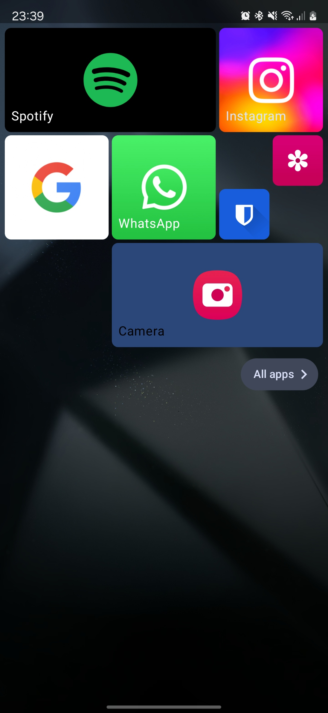
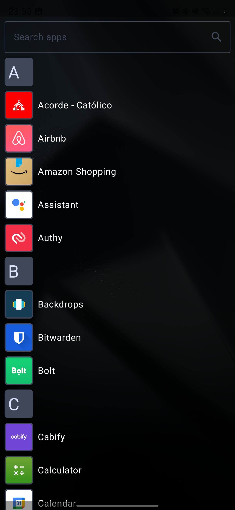

# GridLauncher

## About

**GridLauncher** is a modern, fluid Android launcher inspired by the Windows Phone Metro design, built entirely with Jetpack Compose. It features a customizable 8-column grid, live Apple-style smart tiles (Alarm & Live Clock, Calendar, Flashlight, Battery, Step Counter, Currency Exchange, Weather, Media Player), pinned app shortcuts, seamless edge-to-edge rendering, and native system wallpaper passthrough with translucent glass tiles.

## Key Features

- **Customizable Grid:** High-density 8-column layout with fluid drag-and-drop repositioning and multi-size tile resizing.
- **Smart Live Tiles & Widgets:**
  - **Live Analog Clock & Next Alarm:** Apple-style wide tile with real-time analog clock hands, system alarm synchronization, and countdown badges.
  - **Live Calendar Badge:** Normalizes UTC all-day events and displays upcoming calendar appointments.
  - **Flashlight Tile:** Quick hardware flashlight toggle.
  - **Battery Telemetry:** Live battery percentage, charging state, wattage, and temperature metrics.
  - **Hardware Step Counter:** Daily step tracking using hardware pedometer sensors with midnight reset and reboot continuity.
  - **Currency Exchange Rate:** Real-time currency conversion rates.
  - **Weather Forecast:** Live weather conditions with clean monochrome iconography.
  - **Dynamic Media Player:** Context-aware ephemeral playback control tile with collision-free seam injection.
- **Native System Wallpaper Passthrough:**
  - True window-level system wallpaper passthrough (`android:windowShowWallpaper="true"`) for static, live, and dynamic Android wallpapers.
  - Translucent glass tile appearance with customizable opacity/tint slider.
- **Pinned App Shortcuts:** Pin deep shortcuts directly from third-party apps into the grid seamlessly with native monochrome styling.
- **Banking & UPI Compatibility:** 100% hardened for financial and UPI applications (e.g. BHIM, Google Pay, PhonePe) with a zero-accessibility footprint.
- **Edge-to-Edge:** Native edge-to-edge support with automatic contrast adaptation for system status and navigation bars.

## Download

Get the latest APK releases directly from:
**[GitHub Releases — dhanathirumaran/GridLauncher](https://github.com/dhanathirumaran/GridLauncher/releases)**

1. Navigate to the [Releases](https://github.com/dhanathirumaran/GridLauncher/releases) page.
2. Under the latest build, expand **Assets**.
3. Download the `GridLauncher-v1.0.0-build-XX-release.apk` (or `app-release.apk`) to install on your Android device.

## Screenshots

  
  &nbsp;&nbsp;&nbsp;&nbsp;
  

## Credits & License

GridLauncher is open source and licensed under the [Apache License 2.0](LICENSE).

- **Lineage:** The foundational launcher architecture originated from [Tiago Araujo's](https://github.com/Tgo1014) open-source project.
- **Package Identity:** The application ID and namespace (`tgo1014.gridlauncher`) are preserved to ensure continuous, seamless in-place updates for existing test devices and installations.
- **Active Development:** All active development, feature additions, smart tiles, and releases are developed and maintained at **[dhanathirumaran/GridLauncher](https://github.com/dhanathirumaran/GridLauncher)**.
